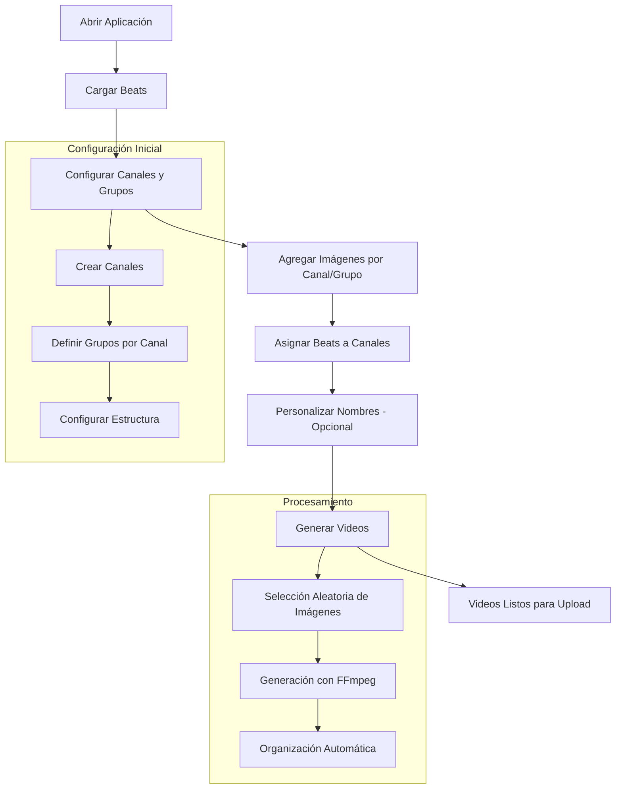

# 🎵 Type Beat Video Generator v2.0

Una aplicación de escritorio profesional para automatizar la generación de videos de type beats para YouTube. Ahora con soporte completo para **videos looped** y **imágenes estáticas** con selección manual y sistema anti-duplicados avanzado.

![Version### 5. 🎬 Generación de Videos con Selección de Contenido
1. **Verificación previa**: Confirma que todos los beats tienen canal y grupo asignado
2. **Carpeta de salida**: Opcionalmente selecciona carpeta personalizada
3. **Inicio**: Haz clic en **"▶️ GENERAR VIDEOS"** para abrir el diálogo de selección
4. **Selección de contenido**: 
   - **🎬 Videos Looped**: Para contenido dinámico con loops automáticos
   - **🖼️ Imágenes Estáticas**: Para método tradicional
5. **Validación**: El sistema verifica contenido suficiente y muestra estadísticas
6. **Procesamiento**: Monitorea progreso en tiempo real con información detallada
7. **Resultado**: Videos organizados automáticamente en estructura `canal/grupo/`

#### 📱 Clip vertical 9:16 (opcional)
Activa **"Generar también clip vertical 9:16"** para obtener, junto a cada video, un `<nombre>_vertical.mp4` de 45 s (1080x1920, recorte centrado, fade de audio) listo para Shorts/Reels/TikTok. Si el beat dura menos de 45 s se usa completo.

#### 🎯 Diálogo de Selección de Contenido:
```
┌─────────────────────────────────────────┐
│  Configurar Generación de Videos        │
├─────────────────────────────────────────┤
│  📁 Canal: mattwyyre / Grupo: Principal │
│  🎵 Beats a procesar: 8                 │
│                                         │
│  📊 Contenido Disponible:               │
│  🖼️ Imágenes: 25 archivos ✅            │
│  🎬 Videos: 12 archivos ✅               │
│                                         │
│  🎯 Tipo de Contenido:                  │
│  ◉ 🎬 Usar Videos Looped                │
│  ○ 🖼️ Usar Imágenes Estáticas           │
│                                         │
│  ✅ Suficientes videos para generar     │
│     sin duplicados                      │
│                                         │
│  [❌ Cancelar] [✅ Continuar]            │
└─────────────────────────────────────────┘
```s://img.shields.io/badge/version-2.0-blue.svg)


## ✨ Características Principales

### 🎬 **NUEVO: Sistema de Videos Looped**
- **Videos de Pinterest**: Sube videos cortos (5-10 segundos) que se repetirán automáticamente
- **Loop inteligente**: Los videos se repiten hasta que termine el audio del beat
- **Selección manual**: Elige entre videos looped o imágenes estáticas para cada sesión
- **Sistema anti-duplicados**: Cada beat usa contenido único, sin repeticiones
- **Calidad profesional**: Videos HD 1920x1080 con loops suaves y naturales
- **Formatos soportados**: MP4, MOV, AVI, MKV, WMV para máxima compatibilidad

### 📁 **Gestión Inteligente de Contenido**
- **Estructura dual**: Carpetas separadas para `images/` y `videos/`
- **Organización por canal/grupo**: Misma jerarquía para ambos tipos de contenido
- **Subida unificada**: Botón "📁 Subir Contenido" para imágenes y videos
- **Detección automática**: El sistema cuenta contenido disponible en tiempo real
- **Validación previa**: Verifica suficiente contenido antes de generar
- **Tracking inteligente**: Sin repetición hasta agotar toda la biblioteca

### 🎶 Gestión de Audio
- **Carga masiva de beats**: Soporte para archivos .wav, .mp3, .flac
- **Procesamiento batch**: Hasta 30 archivos simultáneos
- **Vista previa detallada**: Información completa de archivos con duración y formato
- **Edición de nombres**: Personalización de nombres para videos finales
- **Gestión inteligente**: Organización automática en carpeta `beats/`

### 📺 Sistema Avanzado de Canales y Grupos
- **Gestión multichannel**: Creación y administración de múltiples canales de YouTube
- **Organización por grupos**: Clasificación dentro de cada canal (ej: "mattwyyre" → "Principal", "Trap", "Guitarra", "R&B")
- **Asignación inteligente**: Vinculación de beats específicos a canales y grupos
- **Estructura automática**: Sistema de carpetas organizadas por canal/grupo
- **Configuración persistente**: Guardado automático de configuraciones de canales

### 🖼️ Gestión Inteligente de Imágenes y Videos
- **Doble sistema**: Soporte para imágenes estáticas Y videos looped
- **Organización jerárquica**: Estructura `images/{canal}/{grupo}/` y `videos/{canal}/{grupo}/`
- **Selección sin repetición**: Algoritmo que evita duplicados en cada procesamiento
- **Formatos soportados**: 
  - **Imágenes**: JPG, PNG, JPEG, BMP, GIF
  - **Videos**: MP4, MOV, AVI, MKV, WMV
- **Gestión visual**: Interface para administrar contenido por categoría
- **Backup automático**: Copia de imágenes utilizadas junto a videos generados
- **Escalado inteligente**: Adaptación automática a 1920x1080 manteniendo proporción

### 🎬 Generación Profesional de Videos
- **Formato optimizado**: MP4 (1920x1080, 16:9) compatible con YouTube
- **Procesamiento FFmpeg**: Integración nativa con FFmpeg 8.0 incluido
- **Videos looped**: Repetición automática de clips cortos hasta duración del beat
- **Imágenes estáticas**: Soporte completo para el método tradicional
- **Escalado inteligente**: Centrado automático con relleno negro para cualquier proporción
- **Calidad premium**: Video H.264 con audio AAC 192kbps
- **Progreso en tiempo real**: Monitoreo detallado del procesamiento
- **Organización automática**: Videos exportados en estructura `canal/grupo/`
- **Nombres personalizables**: Formato automático o nombres custom
- **Selección de contenido**: Diálogo previo para elegir imágenes o videos

### 🖱️ Interfaz Moderna y Profesional
- **Diseño PyQt6**: Interface nativa con tema oscuro profesional
- **Layout de 3 columnas**: Organización intuitiva del flujo de trabajo
- **Indicadores visuales**: Estados claros de progreso y procesamiento
- **Menús contextuales**: Acceso rápido a funciones avanzadas
- **Responsive**: Adaptable a diferentes tamaños de pantalla
- **Iconografía QtAwesome**: Iconos vectoriales profesionales

## 📋 Requisitos del Sistema

### Software Requerido
- **Python 3.13+** (recomendado, compatible con 3.8+)
- **Windows 10/11** (principal), macOS, o Linux
- **4GB RAM** mínimo, 8GB recomendado para procesamiento batch
- **1GB** de espacio libre en disco (sin incluir contenido)

### Dependencias Principales
- `PyQt6==6.9.1` - Interfaz gráfica moderna
- `qdarkstyle` - Tema oscuro profesional  
- `qtawesome` - Iconos vectoriales
- `Pillow` - Manipulación de imágenes
- `FFmpeg 8.0` - Procesamiento multimedia (incluido)

## 🚀 Instalación y Configuración

### ⚡ Instalación Rápida (Windows)
```batch
# Clona el repositorio
git clone https://github.com/Perree/video-type-beat-generator.git
cd video-type-beat-generator

# Opción 1: Ejecuta el instalador automático
start_app.bat

# Opción 2: Ejecuta el nuevo launcher (recomendado)
run_app.bat
```

### 🔧 Instalación Manual Paso a Paso
```bash
# 1. Clona el repositorio
git clone https://github.com/Perree/video-type-beat-generator.git
cd video-type-beat-generator

# 2. Crea entorno virtual (IMPORTANTE)
python -m venv .venv

# 3. Activa el entorno virtual
# Windows PowerShell:
.venv\Scripts\Activate.ps1
# Windows CMD:
.venv\Scripts\activate.bat
# Linux/Mac:
source .venv/bin/activate

# 4. Actualiza pip e instala dependencias
python -m pip install --upgrade pip
pip install PyQt6 qdarkstyle qtawesome Pillow

# 5. Ejecuta la aplicación
python main.py
```

### 🎯 Formas de Ejecutar la Aplicación

**🟢 Método Recomendado (Windows):**
```batch
# Usa el launcher inteligente que detecta el entorno virtual
run_app.bat
```

**🟢 Método Manual (Todas las plataformas):**
```bash
# Activa el entorno virtual y ejecuta
.venv\Scripts\Activate.ps1  # Windows PowerShell
python main.py

# O ejecuta directamente con el Python del entorno virtual
.venv\Scripts\python.exe main.py  # Windows
.venv/bin/python main.py          # Linux/Mac
```

### 🚨 Solución a Error Común: "No module named 'PyQt6'"

Si obtienes el error `ModuleNotFoundError: No module named 'PyQt6'`, es porque no estás usando el entorno virtual:

**❌ INCORRECTO:**
```bash
python main.py  # Usa Python del sistema (sin dependencias)
```

**✅ CORRECTO:**
```bash
# Opción 1: Usa el launcher automático (Windows)
run_app.bat

# Opción 2: Activar entorno virtual primero
.venv\Scripts\Activate.ps1  # Windows PowerShell
python main.py

# Opción 3: Usar Python del entorno directamente
.venv\Scripts\python.exe main.py  # Windows
.venv/bin/python main.py          # Linux/Mac
```

### 🔍 Verificación de Instalación
```bash
# Verifica que PyQt6 esté instalado correctamente
.venv\Scripts\python.exe -c "import PyQt6; print('PyQt6 instalado correctamente')"

# Verifica todas las dependencias
.venv\Scripts\python.exe -c "import PyQt6, qdarkstyle, qtawesome; print('Todas las dependencias OK')"
```

### Configuración Inicial
La aplicación creará automáticamente la siguiente estructura de carpetas:
```
video-type-beat-generator/
├── beats/                  # Archivos de audio (.wav, .mp3, .flac)
├── images/                 # Imágenes organizadas por canal/grupo
│   ├── {canal1}/
│   │   ├── Principal/     # Grupo principal del canal
│   │   ├── Trap/          # Grupo específico (ejemplo)
│   │   └── R&B/           # Otro grupo específico
│   └── {canal2}/
│       └── Principal/
├── videos/                 # 🆕 Videos cortos para loops
│   ├── {canal1}/
│   │   ├── Principal/     # Videos de 5-10 segundos
│   │   │   ├── aesthetic_loop.mp4
│   │   │   ├── trap_vibes.mp4
│   │   │   └── city_night.mp4
│   │   ├── Trap/          # Videos específicos por género
│   │   └── R&B/
│   └── {canal2}/
│       └── Principal/
├── exported_videos/        # Videos generados con estructura organizativa
│   ├── {canal1}/
│   │   ├── Principal/
│   │   │   ├── beat1_{canal1}_Principal.mp4
│   │   │   └── beat1_{canal1}_Principal_imagen.jpg
│   │   └── Trap/
│   └── {canal2}/
├── config/                 # Configuración automática de la aplicación
├── bin/                    # FFmpeg 8.0 incluido (Windows)
└── .venv/                  # Entorno virtual Python
```

## 📖 Guía de Uso Completa

### 🎬 **NUEVO: Trabajar con Videos Looped**

#### 1. 📁 Subir Videos de Pinterest
1. **Preparar videos**: Descarga videos cortos (5-15 segundos) de Pinterest, TikTok o cualquier fuente
2. **Seleccionar canal/grupo**: Elige la categoría en la columna central
3. **Subir contenido**: 
   - Haz clic en **"📁 Subir Contenido"**
   - Selecciona **"🎬 Videos"**
   - Elige múltiples archivos .mp4, .mov, etc.
4. **Verificación**: Los videos se copian automáticamente a `videos/canal/grupo/`

#### 2. 🎯 Generar Videos con Loops
1. **Preparar beats**: Carga y asigna beats a canal/grupo (mismo proceso que siempre)
2. **Iniciar generación**: Haz clic en **"▶️ GENERAR VIDEOS"**
3. **Seleccionar tipo**: En el diálogo emergente, elige **"🎬 Usar Videos Looped"**
4. **Validación automática**: El sistema verifica que tengas suficientes videos únicos
5. **Procesamiento**: Cada beat usará un video diferente, sin repeticiones

#### 3. 💡 Consejos para Videos Looped
- **Duración ideal**: Videos de 8-12 segundos funcionan mejor
- **Variedad**: Sube 15-30 videos por grupo para máxima diversidad
- **Calidad**: Usa videos en HD (1080p) para mejor resultado final
- **Estilo**: Mantén consistencia visual dentro de cada grupo
- **Formato**: MP4 es el más compatible, pero MOV y AVI también funcionan

#### 4. 🔄 Workflow Híbrido (Imágenes + Videos)
Puedes usar ambos tipos de contenido:
- **Sesión 1**: Generar con videos looped para beats dinámicos
- **Sesión 2**: Generar con imágenes estáticas para beats melódicos
- **Organización**: Mantén ambas bibliotecas actualizadas por canal/grupo

#### 5. 📊 Comparación: Videos vs Imágenes

| Aspecto | 🎬 Videos Looped | 🖼️ Imágenes Estáticas |
|---------|------------------|------------------------|
| **Engagement** | ⭐⭐⭐⭐⭐ Muy Alto | ⭐⭐⭐ Moderado |
| **Facilidad** | ⭐⭐⭐⭐ Fácil | ⭐⭐⭐⭐⭐ Muy Fácil |
| **Tamaño archivo** | ⭐⭐⭐ Moderado (10-50MB) | ⭐⭐⭐⭐⭐ Pequeño (2-5MB) |
| **Tiempo render** | ⭐⭐⭐ Moderado | ⭐⭐⭐⭐⭐ Rápido |
| **Impacto visual** | ⭐⭐⭐⭐⭐ Muy Alto | ⭐⭐⭐ Moderado |
| **Retención YouTube** | ⭐⭐⭐⭐⭐ Excelente | ⭐⭐⭐ Buena |

---

### 1. 🎵 Cargar y Gestionar Beats
1. **Carga inicial**: Haz clic en **"Cargar Beats"** en la columna izquierda
2. **Selección múltiple**: Selecciona entre 1-30 archivos de audio (.wav, .mp3, .flac)
3. **Copia automática**: Los archivos se copiarán a la carpeta `/beats` con validación
4. **Vista previa**: Revisa la lista de beats cargados con información detallada
5. **Gestión**: Usa clic derecho para opciones adicionales (eliminar, renombrar)

### 2. 📺 Configuración Avanzada de Canales
1. **Acceso**: Ve a la columna central **"Configuración de Canales"**
2. **Gestión de canales**: Haz clic en **"Gestionar Canales"** para configuración avanzada
3. **Crear canal nuevo**:
   - Haz clic en **"➕ Agregar nuevo canal..."**
   - Ingresa nombre único del canal (validación automática)
   - Define grupos específicos (ej: "Principal", "Trap", "Guitarra", "R&B")
4. **Gestión de imágenes y videos por grupo**:
   - Selecciona canal y grupo específico
   - Usa **"📁 Subir Contenido"** para agregar imágenes o videos
   - Usa **"Editar Imágenes"** para gestión visual (solo imágenes)
   - Agrega 10-50 archivos por grupo para variedad máxima
5. **Configuración automática**: Las configuraciones se guardan automáticamente

### 3. 🎯 Asignación Inteligente de Beats
1. **Selección**: Selecciona uno o múltiples beats de la lista izquierda
2. **Configuración**: Elige canal y grupo específico en configuración central
3. **Asignación**: Haz clic en **"Asignar Canal"** para vincular
4. **Verificación**: Los beats aparecen en la columna derecha **"Lista de Procesamiento"**
5. **Edición**: Modifica asignaciones en cualquier momento

### 4. ✏️ Personalización de Nombres
1. **Acceso**: Doble clic en cualquier beat de la lista de procesamiento
2. **Editor**: Se abre el diálogo de edición de nombres personalizado
3. **Formato automático**: Si se deja vacío, usa formato `nombre_beat_canal_grupo`
4. **Personalización**: Ingresa nombres únicos para optimización SEO
5. **Validación**: Verifica que no existan nombres duplicados

### 5. 🎬 Generación de Videos
1. **Verificación previa**: Confirma que todos los beats tienen canal y grupo asignado
2. **Carpeta de salida**: Opcionalmente selecciona carpeta personalizada
3. **Inicio**: Haz clic en **"▶ GENERAR VIDEOS"** para comenzar procesamiento
4. **Monitoreo**: Observa progreso en tiempo real con información detallada
5. **Resultado**: Videos organizados automáticamente en estructura `canal/grupo/`

### Estructura de Salida Final:
```
exported_videos/
├── mattwyyre/
│   ├── Principal/
│   │   ├── beat1_mattwyyre_Principal.mp4      # Video con loop automático
│   │   └── beat1_mattwyyre_Principal_imagen.jpg  # Solo si usó imágenes
│   ├── Trap/
│   │   ├── beat2_mattwyyre_Trap.mp4           # Cada beat usa contenido único
│   │   └── beat2_mattwyyre_Trap_imagen.jpg
│   └── R&B/
└── wyrelatinbeatz/
    └── Principal/
        ├── beat3_wyrelatinbeatz_Principal.mp4  # Sin duplicados de contenido
        └── beat3_wyrelatinbeatz_Principal_imagen.jpg
```

### 6. 🔄 Gestión de Procesamiento
- **Cancelación**: Usa **"Cancelar"** para detener procesamiento en cualquier momento
- **Progreso**: Monitorea estado actual y tiempo estimado
- **Errores**: Manejo automático de errores con mensajes informativos
- **Backup**: Cada video incluye copia de la imagen utilizada

## 🎯 Flujo de Trabajo Recomendado



### Para Productores Principiantes
1. **Inicio simple**: Carga 5-10 beats para familiarizarte
2. **Un canal básico**: Crea un canal con grupo "Principal"
3. **Imágenes variadas**: Agrega 15-25 imágenes de diferentes estilos
4. **Procesa y aprende**: Genera videos y analiza resultados
5. **Optimiza**: Ajusta nombres y organización según resultados

### Para Productores Experimentados
1. **Organización estratégica**: Estructura beats por género/estilo desde inicio
2. **Múltiples canales**: Crea canales especializados con grupos específicos
3. **Biblioteca extensa**: Mantén 30-50 imágenes por grupo para máxima variedad
4. **Nomenclatura SEO**: Usa nombres personalizados optimizados para búsqueda
5. **Procesamiento masivo**: Aprovecha capacidad de hasta 30 beats simultáneos
6. **Automatización**: Configura una vez y reutiliza configuraciones

### Para Productores Profesionales
1. **Gestión de marca**: Canales diferenciados por marca/nicho musical
2. **Categorización granular**: Grupos específicos por subgéneros musicales
3. **Consistencia visual**: Bibliotecas de imágenes curadas por estilo
4. **Flujo optimizado**: Procesamiento batch regular con nomenclatura sistemática
5. **Distribución organizada**: Estructura lista para upload directo a plataformas

## 🔧 Configuración Avanzada

### Especificaciones Técnicas de Video
- **Resolución**: 1920x1080 (Full HD)
- **Relación de aspecto**: 16:9 (estándar YouTube)
- **Codec de video**: H.264 (máxima compatibilidad)
- **Codec de audio**: AAC, 192 kbps (calidad premium)
- **Formato contenedor**: MP4
- **Escalado**: Automático con relleno negro para mantener proporción
- **Frame rate**: Variable según duración del audio

### Algoritmo de Procesamiento de Imágenes
```python
# Ejemplo del escalado inteligente implementado
def scale_image_to_video(image_path):
    """
    Escala imagen a 1920x1080 manteniendo proporción
    - Centra la imagen
    - Rellena con negro los espacios vacíos
    - Optimiza para cualquier resolución de entrada
    """
    cmd = [
        'ffmpeg',
        '-loop', '1',
        '-i', image_path,
        '-vf', 'scale=-1:1080,pad=1920:1080:(ow-iw)/2:(oh-ih)/2:black',
        '-c:v', 'libx264',
        '-preset', 'fast',
        '-tune', 'stillimage',
        '-shortest'
    ]
```

### Formatos de Audio Soportados
- **WAV**: Calidad sin pérdida (recomendado para masters)
- **MP3**: 128-320 kbps (balance calidad/tamaño)
- **FLAC**: Sin pérdida, menor compatibilidad
- **Duración**: Sin límite específico, optimizado para 2-5 minutos

### Formatos de Imagen Soportados
- **JPG/JPEG**: Formato principal recomendado
- **PNG**: Soporte completo, ideal para imágenes con transparencia
- **Resolución mínima**: 720p (1280x720)
- **Resolución recomendada**: 1080p+ (1920x1080 o superior)
- **Proporción**: Cualquier ratio (se adapta automáticamente)

### Optimizaciones de Rendimiento
- **Procesamiento secuencial**: Un video a la vez para estabilidad
- **Gestión de memoria**: Liberación automática de recursos
- **Cache inteligente**: Reutilización de configuraciones
- **Validación previa**: Verificación de archivos antes de procesamiento

### Configuración de FFmpeg
```bash
# Comando FFmpeg utilizado internamente
ffmpeg -loop 1 -i imagen.jpg -i audio.wav \
  -vf "scale=-1:1080,pad=1920:1080:(ow-iw)/2:(oh-ih)/2:black" \
  -c:v libx264 -preset fast -tune stillimage \
  -c:a aac -b:a 192k -shortest -y output.mp4
```

## 🛠️ Solución de Problemas

### Problemas Frecuentes y Soluciones

**❌ Error: "ModuleNotFoundError: No module named 'PyQt6'"**
- **Causa más común**: No estás usando el entorno virtual donde están instaladas las dependencias
- **Solución**:
  ```bash
  # Verifica que el entorno virtual esté activado
  .venv\Scripts\Activate.ps1  # Windows PowerShell
  
  # O ejecuta directamente con el Python del entorno virtual
  .venv\Scripts\python.exe main.py  # Windows
  .venv/bin/python main.py          # Linux/Mac
  
  # Si PyQt6 no está instalado en el entorno virtual:
  .venv\Scripts\python.exe -m pip install PyQt6 qdarkstyle qtawesome Pillow
  ```

**❌ Error: "No hay imágenes para el canal '{canal}', grupo '{grupo}'"**
- **Causa**: Carpeta de grupo vacía o inexistente
- **Solución**: 
  1. Usa "Gestionar Canales" → "Editar Imágenes"
  2. Agrega mínimo 5-10 imágenes al grupo específico
  3. Verifica que las imágenes estén en formato JPG/PNG

**❌ Error: "FFmpeg no encontrado"**
- **Causa**: FFmpeg no está disponible en el sistema
- **Solución Windows**: 
  1. Verifica que `bin/ffmpeg.exe` existe en carpeta del proyecto
  2. Descarga FFmpeg 8.0 si falta
- **Solución Linux/Mac**: Instala FFmpeg: `sudo apt install ffmpeg` / `brew install ffmpeg`

**❌ Videos con calidad degradada**
- **Causa**: Archivos fuente de baja calidad
- **Solución**:
  1. Usa archivos WAV en lugar de MP3 comprimido
  2. Utiliza imágenes de resolución 1920x1080 o superior
  3. Verifica que imágenes no estén sobre-comprimidas

**❌ Aplicación lenta o se congela**
- **Causa**: Recursos insuficientes o archivos muy pesados
- **Solución**:
  1. Procesa menos beats simultáneamente (10-15 en lugar de 30)
  2. Cierra otras aplicaciones para liberar RAM
  3. Usa imágenes de tamaño moderado (2-5MB máximo)
  4. Verifica espacio disponible en disco

**❌ Error: "Archivo en uso" o "Acceso denegado"**
- **Causa**: Archivos bloqueados por otro proceso
- **Solución**:
  1. Cierra reproductores de audio que puedan usar los beats
  2. Verifica permisos de escritura en carpetas de salida
  3. Ejecuta como administrador si es necesario (Windows)

**❌ Nombres de archivos duplicados**
- **Causa**: Nomenclatura automática genera nombres idénticos
- **Solución**:
  1. Usa nombres personalizados únicos
  2. Verifica que beats tengan nombres originales diferentes
  3. Revisa configuración de canales/grupos

### Optimización de Rendimiento

**🚀 Para mejorar velocidad de procesamiento:**
1. **SSD recomendado**: Usa disco SSD para carpetas de trabajo
2. **RAM suficiente**: Mínimo 8GB para procesamiento fluido
3. **Archivos optimizados**: Imágenes 2-5MB, audio comprimido moderadamente
4. **Lotes pequeños**: Procesa 10-15 beats por vez para estabilidad

**🔍 Para debugging avanzado:**
```bash
# Windows (PowerShell)
python main.py > debug.log 2>&1

# Linux/Mac
python main.py 2>&1 | tee debug.log
```

### Mensajes de Estado de la Aplicación
- **"Procesando: {beat} ({n}/{total})"**: Progreso normal
- **"Generando video para: {beat}"**: Procesando con FFmpeg
- **"Proceso completado!"**: Finalización exitosa
- **"Proceso cancelado por el usuario"**: Cancelación manual
- **"Error: {detalle}"**: Problema específico requiere atención

## 📁 Estructura del Proyecto

```
video-type-beat-generator/
├── 📄 main.py                    # Aplicación principal con interfaz PyQt6
├── 📄 edit_beat_dialog.py        # Diálogo para edición de nombres de beats
├── 📄 start_app.bat              # Launcher automático para Windows (legacy)
├── 📄 run_app.bat                # Launcher inteligente con verificación de entorno virtual
├── 📄 requirements.txt           # Dependencias del proyecto (legacy)
├── 📄 README.md                  # Documentación completa del proyecto
├── 📄 PROJECT_PLAN_Version3.md   # Plan técnico y especificaciones
├── � GESTION_CANALES_GUIDE.md   # Guía específica de gestión de canales
├── �📁 beats/                     # 🎵 Archivos de audio para procesamiento
│   ├── beat1.wav
│   ├── beat2.mp3
│   └── ...
├── 📁 images/                    # 🖼️ Biblioteca de imágenes organizadas
│   ├── canal1/
│   │   ├── Principal/
│   │   │   ├── imagen1.jpg
│   │   │   └── imagen2.png
│   │   ├── Trap/
│   │   └── R&B/
│   └── canal2/
│       └── Principal/
├── 📁 exported_videos/           # 🎬 Videos generados organizados por canal/grupo
│   ├── canal1/
│   │   ├── Principal/
│   │   │   ├── beat1_canal1_Principal.mp4
│   │   │   └── beat1_canal1_Principal_imagen.jpg
│   │   └── Trap/
│   └── canal2/
├── 📁 demo_images/               # 🎨 Imágenes de demostración incluidas
├── 📁 config/                    # ⚙️ Configuración automática de la aplicación
│   └── app_config.json          # Configuraciones de canales y preferencias
├── 📁 bin/                       # 🔧 Herramientas binarias (Windows)
│   └── ffmpeg.exe               # FFmpeg 8.0 incluido
├── 📁 ffmpeg-8.0/                # 📦 Distribución completa de FFmpeg
│   ├── bin/
│   ├── doc/
│   └── ...
├── 📁 .venv/                     # 🐍 Entorno virtual de Python
│   ├── Scripts/                 # (Windows)
│   ├── bin/                     # (Linux/Mac)
│   └── lib/
└── 📁 __pycache__/               # 🗂️ Archivos Python compilados
```

### Componentes Principales

#### **Código Fuente**
- **`main.py`**: Aplicación principal (1,320+ líneas)
  - Interfaz PyQt6 con tema oscuro
  - Worker thread para procesamiento
  - Gestión de canales y configuración
  - Sistema dual de imágenes y videos
  - Integración con FFmpeg

- **`edit_beat_dialog.py`**: Diálogo de edición (160 líneas)  
  - Interface para personalizar nombres de beats
  - Validación de entrada
  - Integración con ventana principal

- **`content_selection_dialog.py`**: **🆕 Diálogo de selección** (250+ líneas)
  - Interface para elegir entre videos looped o imágenes estáticas
  - Validación de contenido disponible
  - Información en tiempo real sobre archivos
  - Prevención de generación con contenido insuficiente

#### **Estructura de Datos**
- **`beats/`**: Almacén centralizado de archivos de audio
- **`images/{canal}/{grupo}/`**: Biblioteca de imágenes organizadas jerárquicamente
- **`videos/{canal}/{grupo}/`**: **🆕 Biblioteca de videos** para loops automáticos
- **`exported_videos/{canal}/{grupo}/`**: Salida estructurada para upload
- **`config/app_config.json`**: Configuración persistente

#### **Herramientas**
- **`bin/ffmpeg.exe`**: Procesador multimedia portable (Windows)
- **`ffmpeg-8.0/`**: Distribución completa con documentación
- **`.venv/`**: Entorno aislado con dependencias específicas

## 🔄 Versionado y Actualizaciones

### Versión Actual: v2.0 (Septiembre 2025)
**Sistema de Videos Looped + Migración PyQt6**

#### ✨ Nuevas Características v2.0:
- **🎬 Sistema de Videos Looped**: Soporte completo para videos de Pinterest/TikTok
  - Loop automático de videos cortos hasta duración del beat
  - Estructura dual `images/` y `videos/` con misma organización
  - Diálogo de selección manual entre imágenes o videos
  - Sistema anti-duplicados avanzado para contenido único
  - Formatos soportados: MP4, MOV, AVI, MKV, WMV
- **� Gestión Unificada de Contenido**: Botón "Subir Contenido" para imágenes y videos
- **🎯 Selección Inteligente**: Validación previa con estadísticas de contenido disponible
- **�🔧 PyQt6**: Migración completa desde PyQt5
  - Eliminación de warnings de deprecación  
  - Compatibilidad con Python 3.13+
  - Mejor rendimiento y estabilidad
- **🧹 Simplificación**: Eliminación de sistemas no esenciales
  - Removido sistema de miniaturas automáticas (enfoque en video)
  - Removido sistema de overlays (simplificación workflow)
  - Core optimizado para generación de videos únicamente

#### 📋 Cambios Técnicos v2.0:
```diff
+ PyQt6 6.9.1 (reemplaza PyQt5 5.15.9)
+ Python 3.13+ soporte nativo
+ Sistema de videos looped con FFmpeg
+ Diálogo de selección de contenido
+ Estructura dual images/ y videos/
+ Sistema anti-duplicados por sesión
+ Validación previa de contenido disponible
+ Eliminación de warnings de deprecación sipPyTypeDict()
+ Estructura de código simplificada y optimizada
- Sistema de thumbnails automático removido
- Sistema de overlays PNG removido  
- Dependencias reducidas para mejor portabilidad
```

### Historial de Versiones

#### **v2.0** (Septiembre 2025) - **Versión Actual**
- Migración PyQt5 → PyQt6
- Eliminación de sistemas de miniaturas y overlays
- Optimización para Python 3.13+
- Simplificación del workflow

#### **v1.0** (Enero 2024) - **Versión Estable Legacy**
- Primera versión estable completa
- Sistema de miniaturas automático
- Sistema de overlays PNG
- PyQt5 + Python 3.8+

#### **v0.9** (Diciembre 2023) - **Beta Avanzada**
- Optimizaciones de rendimiento
- Interface mejorada
- Sistema de canales robusto

#### **v0.8** (Noviembre 2023) - **MVP Funcional**
- Funcionalidad básica de generación
- Gestión inicial de canales
- Procesamiento batch básico

### Roadmap Futuro

#### **v2.1** (Planeado Q4 2025)
- [ ] Procesamiento paralelo multi-thread
- [ ] Presets de configuración exportables  
- [ ] Integración con API de YouTube para metadata
- [ ] Sistema de plantillas de nombres avanzado

#### **v2.2** (Planeado Q1 2026)
- [ ] Soporte para videos de fondo en loop
- [ ] Efectos visuales básicos para imágenes
- [ ] Exportación en múltiples formatos (4K, vertical, etc.)
- [ ] Dashboard de analíticas de producción

#### **v3.0** (Visión a largo plazo)
- [ ] Interfaz web complementaria
- [ ] Integración con servicios cloud
- [ ] IA para selección automática de imágenes
- [ ] Sistema de colaboración multi-usuario

### Política de Soporte
- **v2.x**: Soporte activo y actualizaciones
- **v1.x**: Soporte legacy hasta Diciembre 2025
- **v0.x**: Deprecado, sin soporte

## 👨‍💻 Información Técnica y Créditos

### Arquitectura del Software
- **Framework GUI**: PyQt6 6.9.1 (multiplataforma)
- **Procesamiento multimedia**: FFmpeg 8.0 (incluido)
- **Lenguaje**: Python 3.13+ (compatible desde 3.8+)
- **Gestión de imágenes**: Pillow (PIL) para manipulación
- **Threading**: QThread para procesamiento no-bloqueante
- **Persistencia**: JSON para configuración ligera

### Dependencias Actuales
```python
# requirements.txt actualizado
PyQt6>=6.9.1          # Interfaz gráfica moderna
qdarkstyle>=3.2.3      # Tema oscuro profesional  
qtawesome>=1.4.0       # Iconos vectoriales
Pillow>=9.0.0          # Manipulación de imágenes
```

### Métricas del Proyecto
- **Líneas de código**: ~1,580 líneas Python (main.py: 1,320+, dialogs: 260+)
- **Archivos principales**: 3 módulos Python
- **Funcionalidades**: 30+ métodos principales
- **Formatos soportados**: 11 tipos de archivo (audio + imagen + video)
- **Capacidad**: Hasta 30 beats simultáneos
- **Sistema anti-duplicados**: Tracking inteligente de contenido usado
- **Tiempo desarrollo**: 14+ meses de iteración

### Desarrollado por
**[Perree](https://github.com/Perree)** - Desarrollador Principal
- Arquitectura y diseño de la aplicación
- Implementación de interfaz PyQt6
- Integración con FFmpeg y procesamiento multimedia
- Sistema de gestión de canales y organización

### Tecnologías y Herramientas
- **🐍 Python**: Lenguaje principal con tipado dinámico
- **🖼️ PyQt6**: Framework GUI nativo multiplataforma
- **🎬 FFmpeg**: Procesamiento multimedia de nivel profesional
- **🎨 QDarkStyle**: Tema oscuro para interfaces profesionales
- **📁 Pillow**: Biblioteca de manipulación de imágenes
- **⚡ QtAwesome**: Iconografía vectorial escalable

### Inspiración y Propósito
Este proyecto nació de la necesidad de automatizar la producción de contenido visual para type beats, eliminando el trabajo manual repetitivo y permitiendo a los productores enfocarse en la creación musical. 

**Filosofía del proyecto:**
- **Automatización inteligente**: Reduce trabajo manual manteniendo control creativo
- **Organización sistemática**: Estructura que escala con el crecimiento del productor
- **Calidad profesional**: Resultados aptos para monetización en plataformas
- **Simplicidad de uso**: Interface intuitiva sin sacrificar funcionalidad avanzada

### Contribuciones y Agradecimientos
- **Comunidad FFmpeg**: Por la herramienta de procesamiento multimedia
- **Qt Project**: Por el framework de interfaz gráfica
- **Python Software Foundation**: Por el ecosistema de desarrollo
- **Productores musicales**: Por feedback y casos de uso reales

---

## 📞 Soporte y Comunidad

### Canales de Soporte
- **🐛 Issues GitHub**: [Reportar problemas](https://github.com/Perree/video-type-beat-generator/issues)
- **📚 Wiki**: [Documentación extendida](https://github.com/Perree/video-type-beat-generator/wiki)
- **💬 Discussions**: [Preguntas y sugerencias](https://github.com/Perree/video-type-beat-generator/discussions)

### Cómo Reportar Problemas
1. **Revisa issues existentes** para evitar duplicados
2. **Incluye información del sistema** (OS, Python version, etc.)
3. **Describe pasos exactos** para reproducir el problema
4. **Adjunta logs de error** si están disponibles
5. **Especifica comportamiento esperado** vs. actual

### Contribuir al Proyecto
```bash
# Fork y clonar el repositorio
git clone https://github.com/tu-usuario/video-type-beat-generator.git
cd video-type-beat-generator

# Crear rama para nueva funcionalidad
git checkout -b feature/nueva-caracteristica

# Configurar entorno de desarrollo
python -m venv .venv
.venv/Scripts/activate  # Windows
pip install PyQt6 qdarkstyle qtawesome Pillow

# Realizar cambios y testing
python main.py  # Probar cambios

# Commit y push
git add .
git commit -m "Add: descripción de la nueva característica"
git push origin feature/nueva-caracteristica

# Crear Pull Request en GitHub
```

### Tipos de Contribuciones Bienvenidas
- **🐛 Bug fixes**: Corrección de errores existentes
- **✨ New features**: Funcionalidades nuevas (discutir antes en Issues)
- **📝 Documentation**: Mejoras en documentación y guías
- **🎨 UI/UX**: Mejoras en interfaz y experiencia de usuario
- **🔧 Performance**: Optimizaciones de rendimiento y memoria
- **🌐 Translations**: Internacionalización y traducciones

---

## 📜 Licencia

Este proyecto está licenciado bajo **MIT License**. Ver [LICENSE](LICENSE) para detalles completos.

### Resumen de Permisos
- ✅ **Uso comercial**: Puedes usar la aplicación para proyectos comerciales
- ✅ **Modificación**: Puedes modificar el código fuente libremente  
- ✅ **Distribución**: Puedes distribuir copias originales o modificadas
- ✅ **Uso privado**: Uso personal sin restricciones

### Limitaciones
- ❌ **Sin garantía**: Software proporcionado "as-is" sin garantías
- ❌ **Sin responsabilidad**: Desarrolladores no son responsables por daños
- ⚠️ **Atribución requerida**: Mantener copyright en copias/modificaciones

---

*¿Te gusta el proyecto? Dale una ⭐ en GitHub y compártelo con otros productores musicales!*

**Estadísticas del proyecto**:   