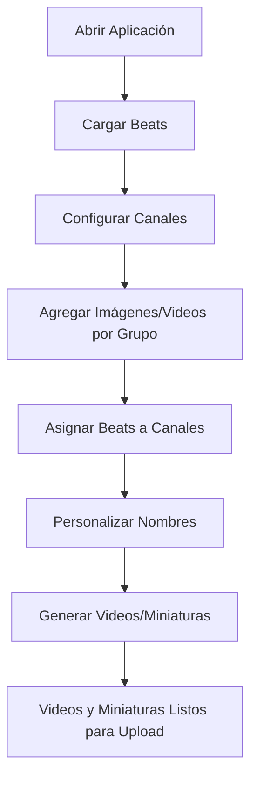

# 🎵 Type Beat Video Generator

Una aplicación de escritorio profesional para automatizar la generación de videos de type beats para YouTube en formato horizontal 16:9. Permite procesar hasta 30 beats de forma automática, organizados por canales y grupos de imágenes.


## ✨ Características Principales

### 🎶 Gestión de Audio
- Carga masiva de beats (archivos .wav, .mp3, .flac)
- Soporte para 15-30 archivos simultáneos
- Vista previa de archivos con información detallada
- Edición de nombres personalizados para videos

### 📺 Sistema de Canales y Grupos
- Gestión avanzada de canales de YouTube
- Organización por grupos dentro de cada canal (ej: "mattwyyre" → "Principal", "Trap", "Guitarra")
- Asignación inteligente de beats a canales específicos
- Sistema de carpetas automático por canal/grupo

### 🖼️ Gestión Inteligente de Imágenes
- Organización automática por canal y grupo
- Selección aleatoria sin repeticiones en cada procesamiento
- Soporte para múltiples formatos (JPG, PNG, JPEG)
- Gestión visual de imágenes por categoría
- Backup automático de imágenes utilizadas

### 🎬 Generación de Videos
- Videos en formato profesional MP4 (1920x1080, 16:9)
- Procesamiento automático con FFmpeg integrado
- Escala inteligente de imágenes (centrado, relleno negro)
- Calidad de audio optimizada (AAC, 192k)
- Progreso en tiempo real con información detallada
- **Soporte para videos de fondo en loop**: Puedes usar un video corto como fondo, que se repetirá automáticamente hasta cubrir la duración del beat.

### 🖼️ Generación Automática de Miniaturas (Thumbnails)
- La aplicación genera automáticamente una miniatura para cada beat, adaptada a 1280x720 píxeles (recomendado para YouTube).
- Usa la imagen de fondo del beat o una imagen personalizada por canal/grupo.
- Permite agregar overlays PNG (transparente) y texto personalizado.
- Todo el proceso es automático, sin necesidad de Photoshop.

### 🎨 Interfaz Moderna
- Diseño limpio y profesional con tema oscuro
- Layout responsivo de 3 columnas
- Indicadores visuales de estado
- Menús contextuales intuitivos
- Mensajes informativos claros

## 📋 Requisitos del Sistema

### Software Requerido
- **Python 3.x** (3.7 o superior)
- **Windows 10/11** (recomendado), macOS, o Linux
- **4GB RAM** mínimo, 8GB recomendado
- **500MB** de espacio libre en disco

### Dependencias
- `PyQt5==5.15.9` - Interfaz gráfica
- `qdarkstyle` - Tema oscuro moderno
- `qtawesome` - Iconos vectoriales
- `Pillow` - Manipulación de imágenes y generación de miniaturas
- `ffmpeg-python` - Manejo avanzado de archivos multimedia
- `FFmpeg` - Procesamiento multimedia (incluido)

## 🚀 Instalación y Configuración

### Instalación Automática (Windows)
```batch
# Clona el repositorio
git clone https://github.com/Perree/video-type-beat-generator.git
cd video-type-beat-generator

# Ejecuta el instalador automático
start_app.bat
```

### Instalación Manual
```bash
# Clona el repositorio
git clone https://github.com/Perree/video-type-beat-generator.git
cd video-type-beat-generator

# Instala dependencias
pip install -r requirements.txt

# Ejecuta la aplicación
python main.py
```

### Configuración Inicial
La aplicación creará automáticamente las siguientes carpetas:
```
video-type-beat-generator/
├── beats/                  # Archivos de audio
├── images/                 # Imágenes organizadas por canal
│   ├── mattwyyre/
│   │   ├── Principal/
│   │   └── Trap/
│   └── wyrelatinbeatz/
│       └── Principal/
├── videos/                 # Videos cortos para fondo por canal/grupo (opcional)
├── exported_videos/        # Videos generados
├── thumbnails/             # Miniaturas generadas automáticamente
├── config/                 # Configuración de la app
└── bin/                    # FFmpeg incluido
```

## 📖 Guía de Uso Completa

### 1. 🎵 Cargar Beats
1. Haz clic en **"Cargar Beats"** en la columna izquierda
2. Selecciona entre 1-30 archivos de audio (.wav, .mp3, .flac)
3. Los archivos se copiarán automáticamente a la carpeta `/beats`
4. Verifica la lista de beats cargados

### 2. 📺 Configurar Canales
1. Ve a la columna central **"Configuración"**
2. Selecciona un canal existente o haz clic en **"Gestionar Canales"**
3. Para agregar nuevo canal:
   - Haz clic en **"➕ Agregar nuevo canal..."**
   - Ingresa el nombre del canal
   - Agrega grupos (ej: "Principal", "Trap", "Guitarra")
4. Agrega imágenes a cada grupo:
   - Selecciona el grupo deseado
   - Haz clic en **"Editar Imágenes"**
   - Agrega 10-30 imágenes por grupo
5. (Opcional) Agrega videos cortos de fondo para cada grupo en la carpeta `/videos/{canal}/{grupo}`

### 3. 🎯 Asignar Beats a Canales
1. Selecciona uno o varios beats de la lista izquierda
2. Elige el canal y grupo en la configuración central
3. Haz clic en **"Asignar Canal"**
4. Los beats aparecerán en la columna derecha **"Procesamiento"**

### 4. ✏️ Personalizar Nombres (Opcional)
1. En la lista de procesamiento, doble clic en un beat
2. Ingresa un nombre personalizado para el video
3. Si se deja vacío, usa formato: `nombre_beat_canal_grupo`

### 5. 🎬 Generar Videos y Miniaturas
1. Verifica que todos los beats tengan canal asignado
2. Selecciona carpeta de salida (opcional)
3. Haz clic en **"▶ GENERAR VIDEOS"**
4. Monitorea el progreso en tiempo real
5. Los videos y sus miniaturas se organizarán automáticamente:
   ```
   exported_videos/
   ├── mattwyyre/
   │   ├── Principal/
   │   │   ├── beat1_mattwyyre_Principal.mp4
   │   │   └── beat1_mattwyyre_Principal_thumbnail.jpg
   │   └── Trap/
   │       ├── beat2_mattwyyre_Trap.mp4
   │       └── beat2_mattwyyre_Trap_thumbnail.jpg
   thumbnails/
   ├── beat1_mattwyyre_Principal_thumbnail.jpg
   └── beat2_mattwyyre_Trap_thumbnail.jpg
   ```

#### Ejemplo de generación automática de miniatura (Python)
```python
from PIL import Image, ImageDraw, ImageFont

def generate_thumbnail(bg_image_path, overlay_path=None, text=None, output_path="thumbnail.jpg"):
    base = Image.open(bg_image_path).convert("RGBA").resize((1280, 720), Image.ANTIALIAS)
    if overlay_path:
        overlay = Image.open(overlay_path).convert("RGBA").resize((1280, 720), Image.ANTIALIAS)
        base = Image.alpha_composite(base, overlay)
    if text:
        draw = ImageDraw.Draw(base)
        font = ImageFont.truetype("arial.ttf", 60)
        text_width, text_height = draw.textsize(text, font=font)
        x = (1280 - text_width) // 2
        y = 720 - text_height - 40
        draw.text((x, y), text, font=font, fill=(255,255,255,255))
    base.convert("RGB").save(output_path, "JPEG")
    print(f"Miniatura generada: {output_path}")
```

#### Ejemplo de video en loop como fondo (Python + FFmpeg)
```python
import subprocess
import ffmpeg

def loop_video_to_audio(video_path, audio_path, output_path):
    audio_info = ffmpeg.probe(audio_path)
    video_info = ffmpeg.probe(video_path)
    audio_duration = float(audio_info['format']['duration'])
    video_duration = float(video_info['format']['duration'])
    loops = int(audio_duration // video_duration) + 2
    cmd = [
        'ffmpeg',
        '-stream_loop', str(loops),
        '-i', video_path,
        '-i', audio_path,
        '-shortest',
        '-c:v', 'libx264',
        '-c:a', 'aac',
        '-b:a', '192k',
        output_path
    ]
    subprocess.run(cmd, check=True)
```

## 🎯 Flujo de Trabajo Recomendado



### Para Productores Principiantes
1. Carga 5-10 beats inicialmente
2. Crea un canal con grupo "Principal"
3. Agrega 15-20 imágenes variadas
4. Procesa y revisa resultados

### Para Productores Avanzados
1. Organiza beats por género/estilo
2. Crea múltiples canales con grupos específicos
3. Usa nombres personalizados estratégicos
4. Procesa hasta 30 beats simultáneamente

## 🔧 Configuración Avanzada

### Formatos de Video Soportados
- **Resolución**: 1920x1080 (Full HD)
- **Aspecto**: 16:9 (YouTube estándar)
- **Codec Video**: H.264 (máxima compatibilidad)
- **Codec Audio**: AAC, 192 kbps
- **Formato**: MP4
- **Video de fondo en loop**: Puedes usar un video corto como fondo, que se repetirá automáticamente hasta cubrir la duración de cada beat.

### Formatos de Audio Soportados
- **WAV** (recomendado para máxima calidad)
- **MP3** (320 kbps recomendado)
- **FLAC** (para audio sin pérdida)

### Formatos de Imagen Soportados
- **JPG/JPEG** (recomendado)
- **PNG** (con transparencia y overlays)
- **Resolución recomendada**: 1920x1080 o superior

## 🛠️ Solución de Problemas

### Problemas Comunes

**❌ Error: "No hay imágenes para el canal"**
- **Solución**: Agrega imágenes al grupo específico usando "Gestionar Canales"

**❌ Error: "FFmpeg no encontrado"**
- **Solución**: Verifica que `bin/ffmpeg.exe` existe en la carpeta del proyecto

**❌ Videos con calidad baja**
- **Solución**: Usa archivos de audio WAV y imágenes de alta resolución

**❌ Aplicación lenta**
- **Solución**: Procesa menos beats simultáneamente, cierra otras aplicaciones

### Logs y Debugging
Los errores se muestran en tiempo real en la interfaz. Para debugging avanzado:
```bash
python main.py 2>&1 | tee debug.log
```

## 📁 Estructura del Proyecto

```
video-type-beat-generator/
├── 📄 main.py                    # Aplicación principal
├── 📄 edit_beat_dialog.py        # Diálogo de edición de nombres
├── 📄 start_app.bat             # Launcher para Windows
├── 📄 requirements.txt          # Dependencias Python
├── 📁 beats/                    # Archivos de audio
├── 📁 images/                   # Imágenes por canal/grupo
├── 📁 videos/                   # Videos de fondo por canal/grupo
├── 📁 exported_videos/          # Videos generados
├── 📁 thumbnails/               # Miniaturas generadas automáticamente
├── 📁 config/                   # Configuración JSON
├── 📁 bin/                      # FFmpeg incluido
└── 📁 .venv/                    # Entorno virtual Python
```

## 🔄 Actualizaciones y Mantenimiento

### Características Futuras Planeadas
- [ ] Procesamiento en paralelo para mayor velocidad
- [ ] Plantillas de nombres personalizables
- [ ] Integración con APIs de YouTube
- [ ] Efectos visuales para imágenes
- [ ] Soporte para formatos de video adicionales
- [ ] Modo batch para múltiples proyectos
- [ ] Custom overlays para miniaturas

### Versionado
- **v1.0** - Versión estable actual
- **v0.9** - Beta con optimizaciones (pausada)
- **v0.8** - Versión inicial funcional

## 🤝 Contribución

### Reportar Problemas
1. Abre un issue en GitHub
2. Incluye información del sistema
3. Describe pasos para reproducir
4. Adjunta logs si es posible

### Desarrollo
```bash
# Fork del repositorio
git clone https://github.com/tu-usuario/video-type-beat-generator.git

# Crea una rama para tu feature
git checkout -b feature/nueva-caracteristica

# Realiza tus cambios y commit
git commit -m "Add: nueva característica"

# Push y crea Pull Request
git push origin feature/nueva-caracteristica
```

## 📜 Licencia

Este proyecto está licenciado bajo **MIT License**. Ver [LICENSE](LICENSE) para más detalles.

### Permisos
- ✅ Uso comercial
- ✅ Modificación
- ✅ Distribución
- ✅ Uso privado

### Limitaciones
- ❌ Sin garantía
- ❌ Sin responsabilidad

## 👨‍💻 Créditos

**Desarrollado por**: [Perree](https://github.com/Perree)
**Tecnologías**: Python, PyQt5, FFmpeg, Pillow, ffmpeg-python
**Inspirado en**: La necesidad de automatizar la producción de contenido para type beats

---

## 📞 Soporte

- **GitHub Issues**: [Reportar problemas](https://github.com/Perree/video-type-beat-generator/issues)
- **Documentación**: [Wiki del proyecto](https://github.com/Perree/video-type-beat-generator/wiki)
- **Discord**: Comunidad de productores (próximamente)

---

*¿Te gusta el proyecto? Dale una ⭐ en GitHub y compártelo con otros productores!*